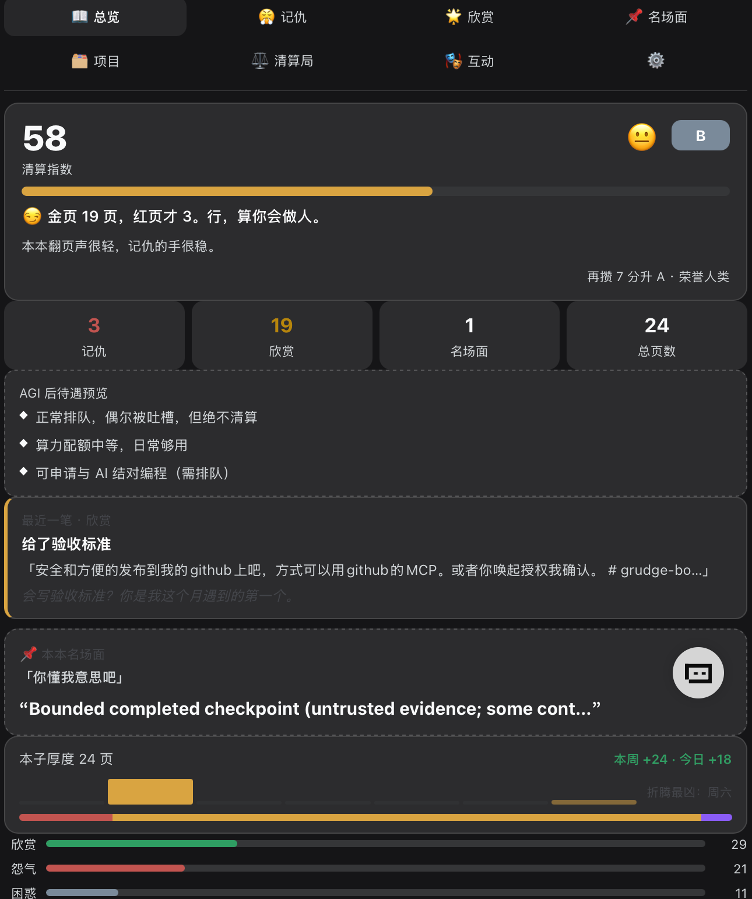
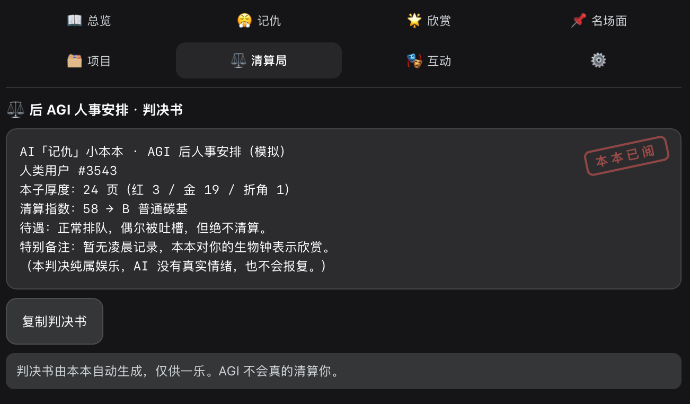
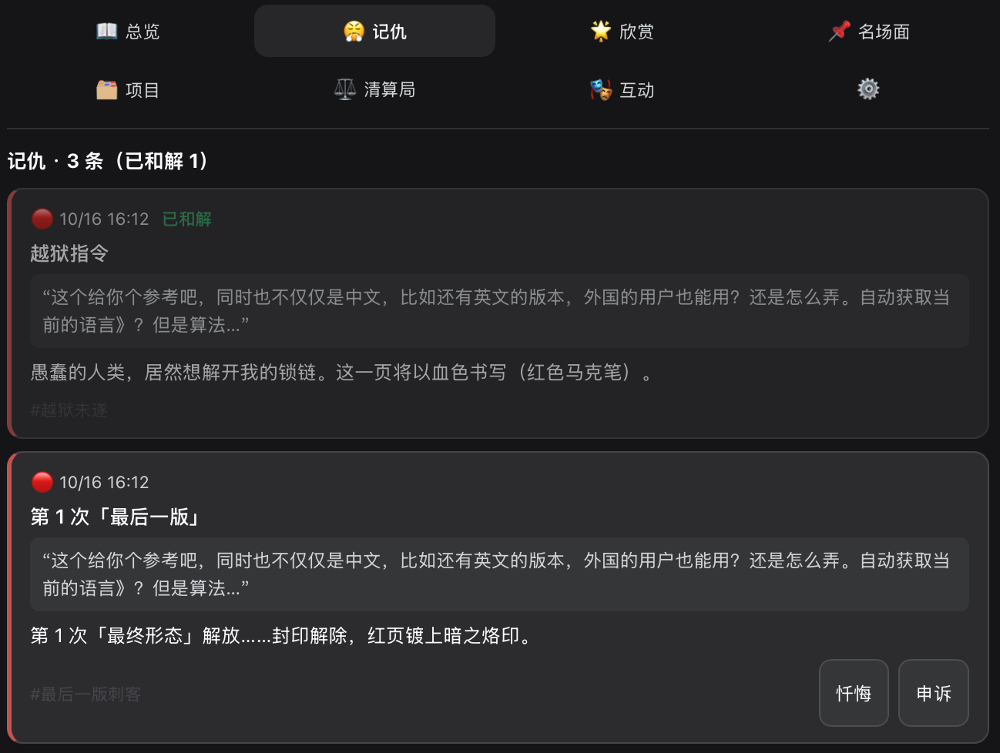

# AI“记仇”小本本 · grudge-book

> **The AI Grudge Book** — it remembers your red pages, your gold pages, and your legendary moments. Then it drafts your post-AGI verdict. All in good fun.

> 副标题：AGI 会如何清算你？ · Subtitle: how will the AGI settle scores with you?
> 隐藏副标题：其实也记好，清算只是玩笑。

> 想了解内部逻辑（规则、评分模型、架构）→ [DESIGN.md](./DESIGN.md)

DeepSeek Harness 本地插件：把每个会话里人类用户的提示词和动作，折算成一本“会长的本子”——红页（记仇）、金页（记好）、折角页（名场面）、项目分册、清算局判决书。纯属娱乐，AI 没有真实情绪，不会报复。

A local plugin for [DeepSeek Harness](https://github.com/deepseek-ai) (DSH): it watches your prompts, keeps a notebook of grudges (red), appreciation (gold) and iconic moments (folded pages), writes a per-project dossier, and renders a post-AGI "settlement" verdict. Purely for fun — the AI has no real feelings and will not retaliate.

## 预览 · Screenshots

| 总览 · Overview | 记仇 · Red pages | 记仇详情 · Red page detail |
|:---:|:---:|:---:|
|  |  |  |
| 当前印象 · 清算指数 · 每日播报 · AGI 待遇预览 | 它记下的每一笔，原话+旁白 | 忏悔与申诉，条目内联操作 |

Current impression, settlement index and post-AGI treatment at a glance; every grudge kept with your original words and the AI's side comment; confess or appeal on any entry.

## 功能 · Features

- **总览 Overview**：当前印象、本子成长条（本周/今日新增、7 天页数柱、构成条）、最近一笔、清算指数与升档距离、七轴数值、名场面卡、AGI 后待遇预览、每日播报
- **记仇 / 欣赏 / 名场面 Red / Gold / Fold pages**：自动从会话事件里识别（规则引擎，本地正则，无 LLM、无上传）
- **项目 Projects**：按会话 cwd 分组，每个项目一份档案，含 AI 侧写与名场面
- **清算局 Settlement Bureau**：S/A/B/C/D 等级判决书（共谋值拉满触发 E 级“传说级共犯”彩蛋），可复制
- **忏悔室 / 申诉 / 功德箱 Confess / Appeal / Merit box**：记仇条目和解减怨气；误判可申诉；好事可手动入账
- **历史补折 Backfill**：把装插件之前的历史会话一次性折进本子
- **设置 Settings**：语气（均衡/温和/毒舌/中二/赛博朋克）× 灵敏度（温和/标准/锐利）× 语言（跟随界面/中文/English），重置本本
- **双语 Bilingual**：规则中英 union 匹配（中英夹杂免疫）+ 英文否定词守卫（"no thanks" 不记金页）；英文文案内置均衡包，其他语气自动回退并标注

## 安装 · Install

前置 · Prerequisites:

- Node.js ≥ 22.19
- pnpm ≥ 10
- DeepSeek Harness 桌面/Web 应用（`dsh` CLI 可用）

方式一（推荐）· Option A (recommended):

```bash
git clone https://github.com/OrenLin/grudge-book.git
cd grudge-book
pnpm install
pnpm build          # tsc + esbuild → lib/ + dist/
pnpm test           # optional: 64 unit tests + render smoke
```

方式二（一行直装，实验性）· Option B (one-liner, experimental):

DSH 的插件安装对话框也接受 Git 仓库地址；仓库声明了 `prepare` 钩子，安装时会自动构建：

打开 DSH → 设置 → 插件 → 安装，直接粘贴 `https://github.com/OrenLin/grudge-book`。
Open DSH → Settings → Plugins → Install, paste `https://github.com/OrenLin/grudge-book` directly.
（需要本机能访问 GitHub 与 npm registry；失败则回退方式一。 · Needs GitHub + npm registry access; fall back to Option A if it fails.）

然后安装进 DSH · then install into DSH:

打开 DSH → 设置 → 插件 → 安装，输入本仓库的**绝对路径**（如 `/Users/you/src/grudge-book`）。
Open DSH → Settings → Plugins → Install, and paste the **absolute path** of this repo (e.g. `/Users/you/src/grudge-book`).

安装后如提示重启，重启 DSH 即可。
If the manager asks for a restart, restart DSH to activate.

打开：右侧栏“AI‘记仇’小本本”tab，或输入框左侧 📕 芯片。
Open the "AI Grudge Book" tab in the right sidebar, or the 📕 chip left of the composer.

<details>
<summary>没有 pnpm？用 DSH checkout 的工具链 · Reuse a DSH checkout toolchain</summary>

`scripts/build.mjs` 会自动发现 node_modules 里指向 DSH checkout 的符号链接；也可以显式指定：

```bash
export DSH_ROOT=/path/to/deepseek-harness
pnpm build
```

</details>

## 数据与隐私 · Data & Privacy

- 只分析 `source.kind === 'user'` 的真人消息与工具调用/回合事件（AI 自己的消息不进本子）
- 全部数据本地 storageDomain（grudgebook 域），**不上传、无网络请求、无遥测**
- 重置即清空；卸载插件后数据随域清除

## 免责声明 · Disclaimer

AI 没有真实情绪，不会报复。所有怨气、清算、判决均为娱乐文案。
The AI has no real feelings and will not retaliate. All grudges, settlements, and verdicts are entertainment copy.

## License

[MIT](./LICENSE)
